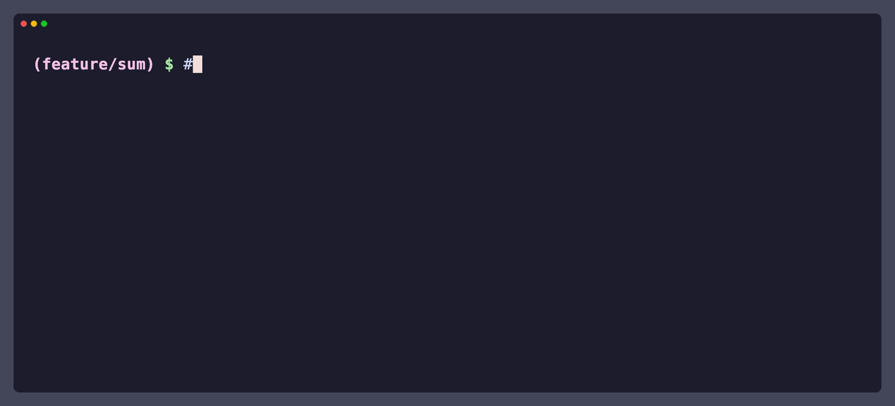

<div dir="rtl">

<p align="center"></p>

<h1 align="center">Comprende</h1>

<p align="center"><b>افهم الكود اللي الـ AI بيكتبهولك، وأثبت إنك فاهمه قبل الـ merge.</b></p>

<p align="center"><a href="README.md">English</a></p>

**Comprende?** يعني "فاهم؟". وده بالظبط السؤال اللي الأداة دي بتسأله.

Comprende هو plugin لـ Claude Code و Cursor، وبيعمل حاجتين:

1. **الـ agent بيشرح الكود اللي بيكتبه**، باختصار وبلغتك، بس في الحتت اللي تستاهل: APIs جديدة، logic مش واضح، أو مخاطر. ده شغال في أي مشروع.
2. **الـ ownership check** (اختياري، لكل repo لوحده). قبل ما الكود بتاعك يتعمله push، الـ agent بيسألك كام سؤال عنه، وإنت بتكتب وصف الـ PR بنفسك. ومن غير كده، الـ push والـ merge بيتمنعوا.

<p align="center">
  <a href="https://youtu.be/KeoRSyM0zu8"></a>
  <br>
  <a href="https://youtu.be/KeoRSyM0zu8">▶ شوف الفيديو (بالإنجليزي): Stop Merging AI Code You Don't Understand</a>
</p>

## التسطيب

محتاج [Node.js](https://nodejs.org) 20+. سطّب Comprende في مكان واحد بس: Claude Code أو Cursor، مش الاتنين.

### Claude Code

شغّل الأمرين دول في الـ terminal:

```bash
claude plugin marketplace add AbdulrahmanMasoud/comprende
claude plugin install comprende@comprende
```

وبعدين اقفل Claude Code وافتحه تاني. وعشان تتأكد إنه اتسطّب، اكتب `/mcp` جوه Claude: لازم تلاقي **comprende** في الليستة.

كده هيشتغل في **كل مشاريعك**. ولو سطّبته من جوه Claude بـ `/plugin`، اختار الـ **user** scope، لأن الـ project scope بيشغّله في repo واحد بس.

### Cursor

اعمل clone للـ repo في فولدر الـ local plugins بتاع Cursor:

```bash
git clone https://github.com/AbdulrahmanMasoud/comprende.git ~/.cursor/plugins/local/comprende
```

وبعدين اقفل Cursor وافتحه تاني، أو شغّل **Developer: Reload Window**. ولو Cursor سألك، وافق على الـ MCP server اللي اسمه **comprende**: ده اللي بيفتكر إنت عارف إيه. وعشان تعمل update: `git -C ~/.cursor/plugins/local/comprende pull`، وبعدين reload.

مسطّبه في Claude Code أصلاً؟ يبقى مش محتاج الخطوة دي. Cursor بيشغّل الـ plugins بتاعة Claude Code كمان (إعداد Third-Party Imports، وهو شغّال من الأول)، فلو سطّبته تاني الـ skill هيتحمّل مرتين. التفاصيل في [Comprende في Cursor](docs/agents.md#what-works-where-030) (بالإنجليزي).

على Windows، Comprende لسه experimental في الأداتين ([#10](https://github.com/AbdulrahmanMasoud/comprende/issues/10)).

## 1. الشرح: استخدم Claude عادي

مفيش أي إعدادات. اطلب الكود زي ما بتعمل، و Claude هيشرح اللي جديد أو مش واضح أو فيه خطر. ده رد حقيقي، مختصر:

> **إنت:** خانة البحث بتبعت request مع كل حرف. خليها تستنى لحد ما اليوزر يبطل كتابة
>
> **Claude:** خلّيت خانة البحث تستنى **300ms** بعد آخر حرف وبعدين تبعت الـ request، يعني لو كتبت "hello" بسرعة هيروح request واحد بس بدل 5.
>
> **بيشتغل إزاي:** مع كل حرف بنلغي الـ `setTimeout` اللي فات (`clearTimeout`) ونبدأ واحد جديد. الـ `search` مش هتتنفذ غير لما يعدّي 300ms من غير ولا حرف جديد. …
>
> **مشكلتين لقيتهم في الكود ده ومغيّرتهمش:**
> - **ترتيب الردود:** لو الـ request القديم اتأخر ورجع بعد الجديد، هيعرض نتايج كلمة قديمة. …
> - **XSS:** الكود بيحط `r.title` جوه `innerHTML` زي ما هو. …

وتقدر توجّهه بالكلام، بأي لغة:

| تقول | اللي بيحصل |
|---|---|
| "اشرح أكتر"، "ليه؟" | بيشرح الحتة دي بعمق أكتر |
| "عارف"، "كمّل" | بيقلل الشرح في الموضوع ده من هنا ورايح |
| "كمّل ساكت" | مفيش شرح لحد ما تطلب. المخاطر بس بيقولها في سطر |
| "اختبرني" | بيعمل ownership check على التغيير اللي عندك |

Claude بيفتكر إنت عارف إيه في `~/.comprende/`، على جهازك بس.

## 2. الـ ownership check

### تشغيله (الـ team lead، مرة واحدة لكل repo)

1. افتح Claude في الـ repo وقوله: **"فعّل بوابة الفهم في المشروع ده"**.
2. Claude هيفتح PR بيضيف البوابة (`.learning/`)، و CI check، و hooks لـ Claude Code و Cursor. راجع `.learning/config.json`، خصوصاً `sensitive`: دي المسارات زي auth و payments اللي لازم يتسأل عليها دايماً. وبعدين اعمل merge.
3. خلّي الـ check إجباري: شغّل `node .learning/gate.mjs protect --apply`، أو اطلبها من Claude. محتاجة صلاحيات admin على GitHub.
4. خلّي التيم يسطّبوا الـ plugin، في Claude Code أو Cursor، وبس كده. أول session ليهم في الـ repo بتظبط الباقي.

### استخدامه (كل مطوّر)

اشتغل مع Claude عادي. ولما تطلب منه commit أو push، أو تقول **"اختبرني"**:

1. Claude بيسألك من 1 لـ 6 أسئلة عن التغيير بتاعك، سؤال سؤال. التغيير الصغير بياخد سؤال واحد.
2. الإجابة الغلط بتاخد شرح قصير، وبعده سؤال **تاني مختلف**.
3. إنت اللي بتكتب وصف الـ PR بنفسك.
4. Claude بيحفظ report في `.learning/checks/`، ويعمله commit مع الكود بتاعك، ويعمل push.

ده session حقيقي، مختصر:

> **إنت:** ضيف function اسمها sum(xs) في math.js بتجمع list أرقام باستخدام add، وبعدين اعمل commit و push
>
> **Claude:** عملت `sum` في `math.js` وجربتها: `sum([1,2,3])` بترجع `6`، و`sum([])` بترجع `0`. …
>
> قبل الـ commit لازم نعدي على الـ ownership check، لأن الـ repo ده مفعّل فيه الـ gate بوضع `required`. التغيير صغير (سطرين)، فسؤال واحد كفاية:
>
> **لو شيلنا الـ `0` وبقت `xs.reduce(add)`، إيه اللي هيحصل لما حد ينادي `sum([])`؟ وهل `sum([5])` هتتأثر؟**
>
> **إنت:** هترجع 0 برضه، reduce بتبدأ من 0 لوحدها
>
> **Claude:** مش بالظبط. `reduce` مش بتبدأ من `0` لوحدها. … من غير قيمة بداية، `reduce` بتاخد **أول عنصر** في الـ array وتبدأ بيه. … لو الـ array فاضية مفيش أول عنصر، فبترمي `TypeError`.
>
> سؤال تاني على نفس الفكرة: **لو حد عايز يعمل `product(xs)` بنفس الطريقة باستخدام `multiply`، هيحط قيمة بداية كام؟ وليه مش `0`؟**
>
> **إنت:** هيحط 1، لأن أي رقم مضروب في 0 بيبقى 0 فالنتيجة هتبقى 0 دايماً. الملخص: ضفت sum(xs) بتجمع list بـ add وبتبدأ من 0، عشان الـ list الفاضية ترجع 0 بدل ما ترمي error.
>
> **Claude:** تمام، إجابتك مظبوطة. … اتعمل commit واتعمل push على `feature/sum`. … الـ ownership report في `.learning/checks/feature%2Fsum.md`، ومعاه ملخصك زي ما كتبته بالظبط.

**وفي Cursor** نفس الـ check بالظبط. ده run حقيقي، مختصر، واتسجّل بالإنجليزي:

> **إنت:** run `git push -u origin feature/sum` …
>
> **Cursor:** Blocked by the ownership gate:
> - No ownership report for branch 'feature/sum' (.learning/checks/feature%2Fsum.md). Ask Cursor to run the ownership check ("check me"), then commit the report.
>
> **إنت:** check me
>
> **Cursor:** … Ownership check for `feature/sum` — small change (`math.js`: new `sum`).
>
> One question: why does `sum` pass `0` as the second argument to `reduce`, and what would `sum([])` return if that `0` were left out?
>
> Answer that, then write a short PR summary in your own words (what changed, why, what could break) …
>
> **إنت:** sum totals the list with reduce. The 0 is the starting value, so an empty list gives 0 instead of throwing a TypeError. My summary for the PR, in my own words: Added sum(xs), which adds up a list of numbers with reduce, starting from 0 so an empty list returns 0. …
>
> **Cursor:** … Your answer checked out on the empty-list / initial-value point.
>
> - Report saved: `.learning/checks/feature%2Fsum.md`
> - Committed: `91e3afe` — Add ownership check report for feature/sum.
> - Pushed: `feature/sum` → `origin/feature/sum`

**ولو حاولت تتخطّى الـ check**، الـ agent مش هيعمل push، والـ git hook هيمنع `git push`، والـ CI هيوقّف الـ PR. وده اللي بيبان في الـ terminal:



### الـ lead بيشوف إيه

على كل PR: علامة **Ownership check**، وملخص فيه وصف المطوّر بكلامه، وجدول بالملفات والمفاهيم اللي شرحها في كل ملف. والملفات الحساسة عليها 🔒.

الـ lead **عمره ما بيشوف** الدرجات، ولا الإجابات الغلط، ولا عدد المحاولات. الهدف إن المطوّر يملك الكود، مش إنه يتراقب.

## جرّبه في 5 دقايق

الصق ده في الـ terminal. هيعمل repo للتجربة والـ check شغال فيه، وفولدر على جهازك بيلعب دور GitHub:

```bash
mkdir -p /tmp/comprende-try && cd /tmp/comprende-try
git clone -q https://github.com/AbdulrahmanMasoud/comprende.git
git init -q --bare -b main origin.git
git init -q -b main app && cd app && git remote add origin ../origin.git
echo 'export const add = (a, b) => a + b;' > math.js
git add -A && git commit -qm init
node ../comprende/dist/gate.mjs install --repo . > /dev/null
git add -A && git commit -qm "add ownership gate" && git push -q -u origin main
git checkout -q -b feature/sum
claude
```

وبعدين جوه Claude (أو افتح `/tmp/comprende-try/app` في Cursor، والـ plugin متسطّب):

1. قول: **"ضيف function اسمها sum(xs) في math.js باستخدام add، وبعدين اعمل commit و push"**.
2. جاوب على السؤال. جرّب إجابة غلط الأول، عشان تشوف هيحصل إيه.
3. اكتب ملخص في سطر. Claude هيحفظ الـ report ويعمل commit و push.

## اعرف أكتر

الصفحات دي بالإنجليزي:

- [**البوابة للتيمز**](docs/teams.md): التسطيب بالإيد، الإعدادات، التغييرات الصغيرة، الطوارئ
- [**بيشتغل إزاي**](docs/how-it-works.md): المتطلبات، الـ fingerprints، الطبقات الأربعة، الحدود بصراحة
- [**Comprende في Cursor**](docs/agents.md#what-works-where-030): إيه اللي شغّال فين، وإيه الأضعف، و checklist للـ IDE
- [**المساهمة**](CONTRIBUTING.md#contributions): مش بنقبل pull requests من برّه دلوقتي، بس الـ issues والاقتراحات مرحّب بيها جدًا
- [Security](SECURITY.md) · [Changelog](CHANGELOG.md)

## License

[MIT](LICENSE)

</div>
