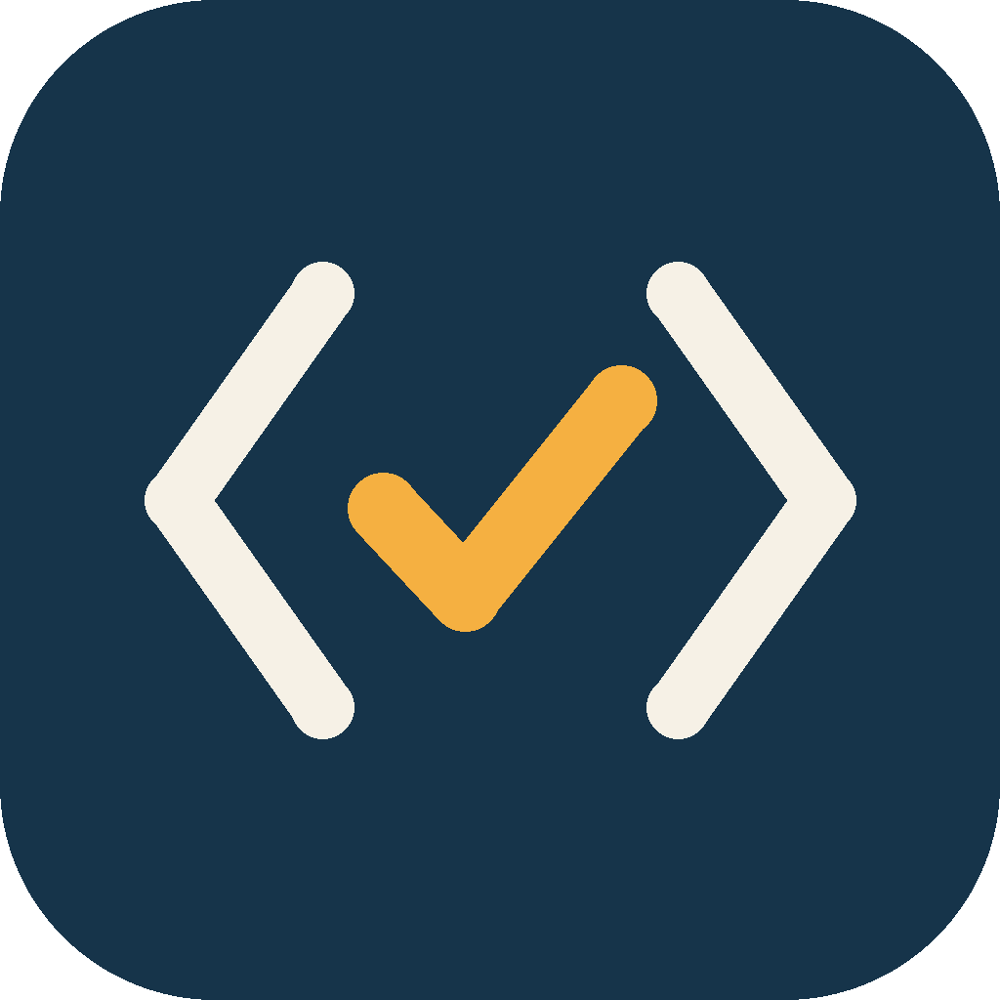
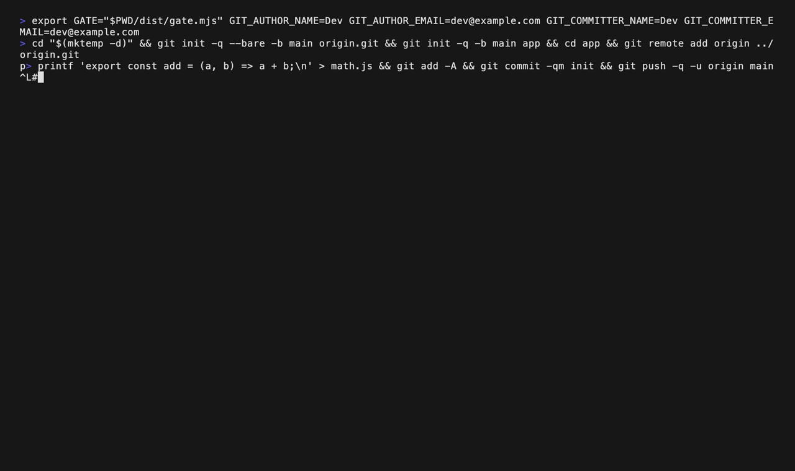

<p align="center"></p>

<h1 align="center">Comprende</h1>

<p align="center"><b>Understand the code AI writes for you, and prove it before you merge.</b></p>

<p align="center"><a href="README.ar.md">Arabic</a></p>

Comprende is a Claude Code plugin with two parts:

1. **Explain as you build.** Claude explains the code it writes: briefly, in your language, and only where it matters (new APIs, non-obvious logic, risks). Boilerplate gets no explanation.
2. **The ownership gate** (optional, for teams). Before a PR, Claude asks the developer a few questions about their change. Without a saved report, the push and the merge are blocked.



## Quick start

Install it in Claude Code. You need Node.js 20+.

```
/plugin marketplace add AbdulrahmanMasoud/comprende
/plugin install comprende@comprende
```

Then:

| You are | Do this |
|---|---|
| **Solo developer** | Nothing else. Build as usual. |
| **Team lead** | In your repo, tell Claude: *"Enable the ownership gate in this repo."* Merge the PR it opens, then run `node .learning/gate.mjs protect --apply` (or ask Claude to) so the check is required. |
| **Team member** | Nothing else. Your first session in the repo sets up the git hook. |

## Talk to it

| Say | What happens |
|---|---|
| "explain more", "why?" | One level deeper on that topic |
| "I know this", "skip" | Less on that topic, from now on |
| "just build" | No explanations until you ask. Risks still get one line |
| "check me" | An ownership check on your current change |

Any language works. Claude remembers what you already know in `~/.comprende/`, on your machine only.

## How a check goes

1. You say **"check me"**, or Claude starts the check before a PR in a gated repo.
2. Claude asks **3 to 6 questions** about your change, or **1** for a small change. No trivia, for example: *"What breaks if we remove the `EXPIRE` call?"*
3. A wrong answer gets a short explanation, then a **different** question.
4. You write the **PR summary** in your own words.
5. Claude saves a report tied to the exact code. You commit it and push.

## What the lead sees

On every PR, the **Ownership check** status and this summary:

> ## ✅ Ownership check passed
> ### The developer's summary
> > Raised the public API rate limit from 10 to 60 per IP per minute because real users were getting blocked. If the gateway only sees the load balancer's IP, the limit becomes global, so verify X-Forwarded-For in staging first.
>
> | File | Concepts the developer explained |
> |---|---|
> | `src/middleware/rateLimit.js` | per-IP sliding window; window size vs effective limit; X-Forwarded-For behind a load balancer |
> | `src/auth/session.js` 🔒 | token expiry; why refresh is single-use |

The lead **never** sees scores, wrong answers or attempts. The goal is ownership, not surveillance.

## Learn more

- [**The gate for teams**](docs/teams.md): setup by hand, settings, small changes, emergencies
- [**How it works**](docs/how-it-works.md): requirements, fingerprints, the four layers, honest limits
- [**Contributing**](CONTRIBUTING.md): layout, tests, the demo, releases
- [Security](SECURITY.md) · [Changelog](CHANGELOG.md)

## License

[MIT](LICENSE)
