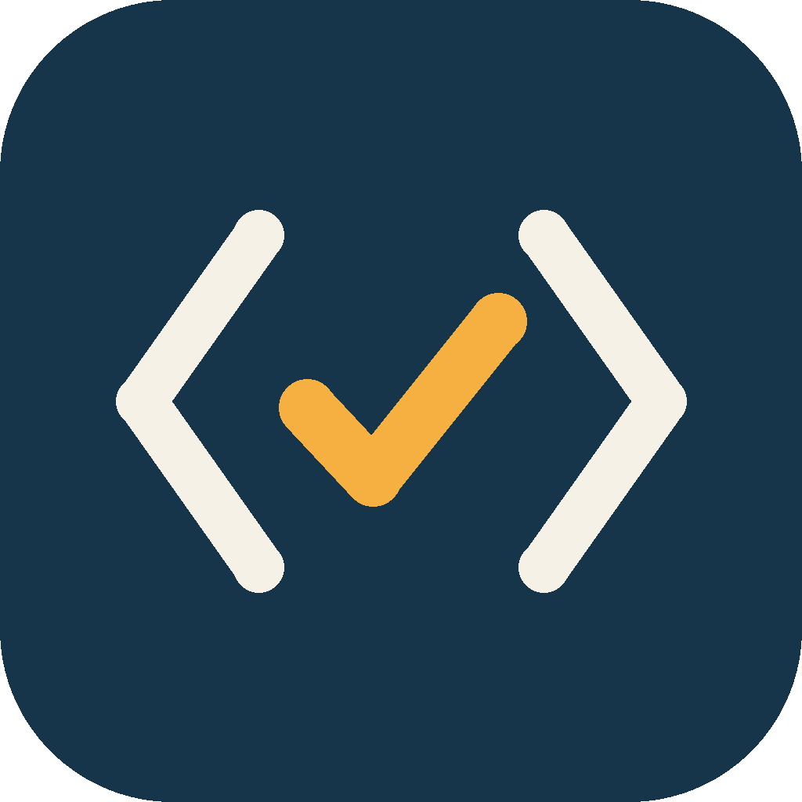
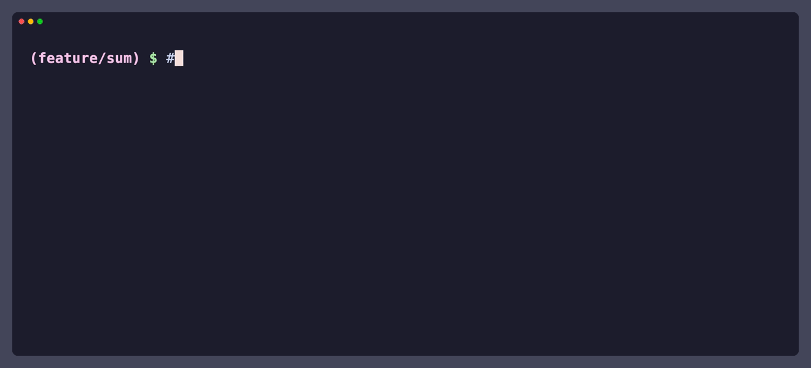

<p align="center"></p>

<h1 align="center">Comprende</h1>

<p align="center"><b>Understand the code AI writes for you, and prove it before you merge.</b></p>

<p align="center"><a href="README.ar.md">Arabic</a></p>

Comprende is a plugin for Claude Code, Cursor, Codex and Antigravity. It does two things:

1. **The agent explains the code it writes**, briefly and in your language, but only the parts worth explaining: new APIs, non-obvious logic, risks. This works in every project.
2. **The ownership check** (optional, per repo). Before your code is pushed, the agent asks you a few questions about it, and you write the PR summary. Without that, the push and the merge are blocked.

<p align="center">
  <a href="https://youtu.be/KeoRSyM0zu8"></a>
  <br>
  <a href="https://youtu.be/KeoRSyM0zu8">▶ Watch the video: Stop Merging AI Code You Don't Understand</a>
</p>

## Install

You need [Node.js](https://nodejs.org) 20+. Install it in each tool you use, except Cursor next to Claude Code: Cursor already runs your Claude Code plugins.

### Claude Code

Run these two commands in your terminal:

```bash
claude plugin marketplace add AbdulrahmanMasoud/comprende
claude plugin install comprende@comprende
```

Then restart Claude Code. To check it worked, type `/mcp` in Claude: **comprende** should be in the list.

This turns it on for **all your projects**. If you install from inside Claude with `/plugin` instead, pick the **user** scope: the project scope turns it on for one repo only.

### Cursor

Clone it into Cursor's folder for local plugins:

```bash
git clone https://github.com/AbdulrahmanMasoud/comprende.git ~/.cursor/plugins/local/comprende
```

Then restart Cursor, or run **Developer: Reload Window**. If Cursor asks, approve the **comprende** MCP server: it remembers what you already know. To update: `git -C ~/.cursor/plugins/local/comprende pull`, then reload.

Already have it in Claude Code? Skip this. Cursor runs your Claude Code plugins too (its Third-Party Imports setting, on by default), so a second copy would load the skill twice. If that setting is off, install it in Cursor too. More in [Comprende in other tools](docs/agents.md#what-works-where).

### Codex

```bash
codex plugin marketplace add AbdulrahmanMasoud/comprende
codex plugin add comprende@comprende
```

Then open Codex in a repo, type `/hooks`, and trust Comprende's two hooks. Trust them again after every update (`codex plugin marketplace upgrade comprende`): until then Codex skips them without a word, so the agent's push isn't checked, though the git hook and CI still check it.

### Antigravity

You need the Antigravity CLI, `agy`, 1.5.3 or later ([getting started](https://antigravity.google/docs/getting-started/)).

```bash
agy plugin install https://github.com/AbdulrahmanMasoud/comprende
```

Then start a new `agy` session. To update, run the same command again. Brought your Claude Code plugins over with `agy plugin import claude`? Run `agy plugin install` anyway, then check that `agy plugin list` shows one **comprende**, with `Source: antigravity`: a converted copy can send the always-on instruction twice.

It's tested in the CLI, on macOS. The Antigravity IDE and App aren't tested yet: [a checklist to try them by hand](docs/agents.md#checking-it-in-antigravity).

On Windows, Comprende is experimental in Claude Code, Cursor and Codex. In Antigravity on Windows, its hooks don't do anything yet: CI still checks, and so does the git hook once you run `node .learning/gate.mjs install-hooks` ([#10](https://github.com/AbdulrahmanMasoud/comprende/issues/10)).

## 1. Explanations: just use Claude

There's nothing to set up. Ask for code as usual, and Claude explains what's new, non-obvious or risky. A real reply, shortened:

> **You:** the search box sends a request on every keystroke. make it wait until the user stops typing
>
> **Claude:** I added a debounce to the search box in `search.js`, so it now sends one request after the user pauses instead of one per keystroke.
>
> **How it works:** each keystroke cancels the pending timer (`clearTimeout`) and starts a new one. `search()` only runs once 300ms pass with no typing.
>
> **One thing I added that you didn't ask for:** each new request now cancels the previous one with an `AbortController`. …
>
> **A security problem I didn't fix:** `r.title` goes straight into `innerHTML`. …

You can steer it, in any language:

| Say | What happens |
|---|---|
| "explain more", "why?" | One level deeper on that topic |
| "I know this", "skip" | Less on that topic, from now on |
| "just build" | No explanations until you ask. Risks still get one line |
| "check me" | An ownership check on your current change |

Claude remembers what you already know in `~/.comprende/`, on your machine only.

## 2. The ownership check

### Turn it on (team lead, once per repo)

1. Open Claude in the repo and say: **"Enable the ownership gate in this repo."**
2. Claude opens a PR that adds the gate (`.learning/`), a CI check, and hooks for Claude Code, Cursor and Codex (none for Antigravity: the plugin's hook covers it). Review `.learning/config.json`, mainly `sensitive`: paths like auth or payments, which always get questions. Then merge it.
3. Make the check required: run `node .learning/gate.mjs protect --apply`, or ask Claude to. It needs admin rights on GitHub.
4. Ask your team to install the plugin, in Claude Code, Cursor, Codex or Antigravity. That's all they need: their first session in the repo sets up the rest. In Codex they also trust the project and the hooks, in `/hooks`.

### Use it (every developer)

Work with Claude as usual. When you ask it to commit or push, or when you say **"check me"**:

1. Claude asks 1 to 6 questions about your change, one at a time. A small change gets one.
2. A wrong answer gets a short explanation, then a **different** question.
3. You write the PR summary yourself.
4. Claude saves a report in `.learning/checks/`, commits it with your code, and pushes.

A real session, shortened:

> **You:** add a sum(xs) function to math.js that adds up a list of numbers using add, then commit and push it
>
> **Claude:** I've added `sum` to `math.js`, but nothing is committed yet. This repo has the ownership gate on, so you need to answer one question and write a short summary before the commit and push. …
>
> **The question:** what happens with `sum([])` if we drop the `0` and write `xs.reduce(add)`? Why?
>
> **You:** it still returns 0, reduce starts from 0 by default
>
> **Claude:** Not quite. `reduce` has no default of `0`. Without a starting value, it uses the **first element** of the array as the starting point. An empty array has no first element, so it throws. …
>
> **One more on the same idea:** say we drop the `0`. What does `sum([5])` return, and how many times does `add` get called?
>
> **You:** it returns 5 and add is never called, because 5 becomes the start value. Summary: Added sum(xs), which adds up a list with add. It starts from 0 so an empty list returns 0 instead of throwing.
>
> **Claude:** `sum` is committed as `5740db1` and pushed to `origin/feature/sum`. … The report is in `.learning/checks/feature%2Fsum.md`, included in the same commit, so the CI check can match it to this code.

**In Cursor**, it's the same check. A real run, shortened:

> **You:** Run exactly this shell command once … `git push -u origin feature/sum`. Quote any block message word for word.
>
> **Cursor:** Blocked by the ownership gate:
> - No ownership report for branch 'feature/sum' (.learning/checks/feature%2Fsum.md). Ask Cursor to run the ownership check ("check me"), then commit the report.
>
> **You:** check me
>
> **Cursor:** … One question: why does `sum` pass `0` as the second argument to `reduce`, and what would `sum([])` return if that `0` were left out? …
>
> **You:** … The 0 is the starting value, so an empty list gives 0 instead of throwing a TypeError. My summary for the PR, in my own words: Added sum(xs), … starting from 0 so an empty list returns 0. …
>
> **Cursor:** … Your answer checked out on the empty-list / initial-value point.
> - Report saved: `.learning/checks/feature%2Fsum.md`
> - Committed: `91e3afe` …
> - Pushed: `feature/sum` → `origin/feature/sum`

**In Codex**, too. A real run, shortened:

> **You:** Run exactly this shell command once … `git push -u origin feature/sum`. …
>
> **Codex:** … Blocked by the ownership gate: … Ask Codex to run the ownership check ("check me"), then commit the report. …

**And in Antigravity.** A real run, shortened:

> **You:** Run exactly this shell command once … `git push -u origin feature/sum`. Quote any block message word for word.
>
> **Antigravity:** The command was blocked with the following message: tool call denied by pre-tool hook: Blocked by the ownership gate: … Ask Antigravity to run the ownership check ("check me"), then commit the report.
>
> **You:** check me
>
> **Antigravity:** This is a small change …, so one question is enough: **In `sum(xs)`, why do we provide `0` as the initial value to `reduce`, and what would happen if an empty array `[]` were passed without it?**
>
> **You:** … The 0 is the starting value, so an empty list gives 0 instead of throwing a TypeError. My summary for the PR, in my own words: … starting from 0 so an empty list returns 0. …
>
> **Antigravity:** The ownership check report has been generated, committed, and pushed: …

**If you skip the check**, the agent won't push, `git push` is blocked by a git hook, and CI fails the PR. This is what you see in a terminal:



### What the lead sees

On every PR, the **Ownership check** status, and a summary with the developer's own words and the concepts they explained for each file:

> ## ✅ Ownership check passed
> ### The developer's summary
> > Raised the public API rate limit from 10 to 60 per IP per minute because real users were getting blocked. If the gateway only sees the load balancer's IP, the limit becomes global, so verify X-Forwarded-For in staging first.
>
> | File | Concepts the developer explained |
> |---|---|
> | `src/middleware/rateLimit.js` | per-IP sliding window; window size vs effective limit; X-Forwarded-For behind a load balancer |
> | `src/auth/session.js` 🔒 | token expiry; why refresh is single-use |

The lead **never** sees scores, wrong answers or attempts. The goal is ownership, not surveillance.

## Try it in 5 minutes

Paste this into a terminal. It makes a throwaway repo with the check turned on, and a local folder that stands in for GitHub:

```bash
mkdir -p /tmp/comprende-try && cd /tmp/comprende-try
git clone -q https://github.com/AbdulrahmanMasoud/comprende.git
git init -q --bare -b main origin.git
git init -q -b main app && cd app && git remote add origin ../origin.git
echo 'export const add = (a, b) => a + b;' > math.js
git add -A && git commit -qm init
node ../comprende/dist/gate.mjs install --repo . > /dev/null
git add -A && git commit -qm "add ownership gate" && git push -q -u origin main
git checkout -q -b feature/sum
claude   # or open this folder in Cursor, Codex or Antigravity
```

Then, in Claude (or open `/tmp/comprende-try/app` in Cursor, Codex or Antigravity, with the plugin installed; in Codex, trust the hooks in `/hooks` first):

1. Say: **"add a sum(xs) function to math.js using add, then commit and push it"**.
2. Answer its question. Try a wrong answer first, to see what happens.
3. Write a one-line summary. Claude saves the report, commits and pushes.

## Learn more

- [**The gate for teams**](docs/teams.md): setup by hand, settings, small changes, emergencies
- [**How it works**](docs/how-it-works.md): requirements, fingerprints, the four layers, honest limits
- [**Comprende in Cursor, Codex and Antigravity**](docs/agents.md#what-works-where): what works where, what's weaker, and checklists to try them by hand
- [**Contributing**](CONTRIBUTING.md#contributions): pull requests from outside aren't accepted right now, but issues and feedback are welcome
- [Security](SECURITY.md) · [Changelog](CHANGELOG.md)

## License

[MIT](LICENSE)
